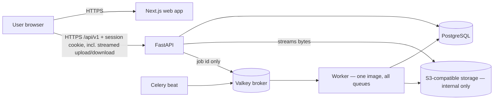
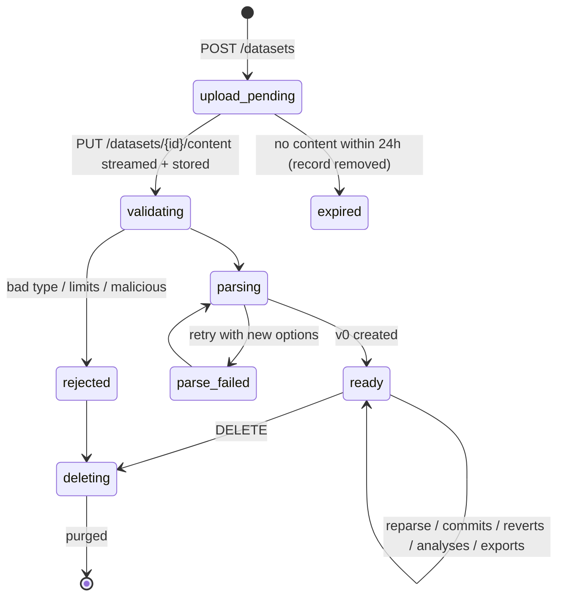

# DataMedic — System Architecture

| | |
|---|---|
| Status | Revision 2, MVP-scoped. Awaiting approval to start Phase 1. |
| Date | 2026-11-06 |

Contents: 1 Principles · 2 System context · 3 Containers · 4 Repository layout · 5 Backend modules · 6 Frontend · 7 Dataset lifecycle & ingest · 8 Analysis lifecycle · 9 Versioning · 10 Job orchestration · 11 Dependency choices · 12 License considerations · 13 Error handling · 14 Testing strategy · 15 Observability · 16 Deployment · 17 Extension points (V2/Future)

---

## 1. Architectural principles

1. **Pure engine, thin shells.** All data-science logic lives in `datamedic_engine`, a pure Python package with no DB, HTTP, Celery or boto3 imports. The API and the worker are adapters around it.
2. **Immutability.** Originals, versions, findings, experiment results and passports are append-only. Undo creates a new version restoring earlier content. Nothing is overwritten.
3. **Declarative specs.** Pipelines are JSON specs validated against the op registry. One spec drives commit, experiments (refit per fold) and code generation.
4. **Separated concerns:**
   - *Diagnose* writes findings only.
   - *Recommend* writes proposals only.
   - *Experiment/Evaluate* writes metrics only and never writes versions. It may use high-risk steps.
   - *Commit (execute)* writes versions, and only from approved specs.
5. **Universal core, domain modules.** Domain modules register roles, checks, rules and ops through one interface. Core packages never import a domain module directly; a registry wires them in.
6. **Ports and adapters for third-party analytics.** Profiling, outlier detection, drift and label-noise are reached through engine *ports* (interfaces). MVP uses built-in or scikit-learn/SciPy implementations, and V2 adds YData Profiling, PyOD and Evidently as alternative adapters without changing callers.
7. **Honest results.** Requirements produce `not_run`, and sampling and approximations are recorded in `limitations`.
8. **Privacy boundary.** Dataset content stays inside the platform. In the MVP no component calls any external service with data, and object storage is not reachable from browsers.
9. **Two layers of tenant isolation.** Owner-scoped service queries, plus Postgres Row-Level Security keyed on `app.user_id`.
10. **Simple first, extensible later.** Each MVP simplification keeps the data model and interfaces compatible with its V2 replacement (§17).

## 2. System context (MVP)



The browser talks only to `web` and `api`. Storage, broker and database are on an internal network. There is no internet egress for `api` or `worker` beyond what the deployment needs (e.g. the SMTP relay for `api`).

## 3. Containers (MVP)

| Container | Tech | Responsibilities |
|---|---|---|
| `web` | Next.js (App Router), React, TypeScript, Tailwind, shadcn/ui | UI. Holds no dataset data on its server. |
| `api` | FastAPI on Uvicorn | Auth, authorisation, CRUD, quotas, job submission, **streaming upload to storage**, **streaming download of exports and passports**, problem+json errors. Does not import pandas or scikit-learn; previews come from a precomputed artifact. |
| `worker` | Celery + `datamedic_engine` + `datamedic_biomedical` (pandas, NumPy, SciPy, scikit-learn, Feature-engine, XGBoost, Cleanlab, statsmodels) | Ingest, analysis, recommendations, experiments, commit, leakage audit, passport, export build + replay validation. **One image.** Queue routing is kept so a heavy/light split later is configuration only. |
| `beat` | Celery beat (same image as `worker`) | Purge, expiry, stale-job reaper, re-enqueue of stuck `queued` jobs |
| `postgres` | PostgreSQL (major pinned in Phase 1) | System of record |
| `broker` | Valkey (preferred) or Redis | Celery transport only. Messages carry IDs only. |
| `storage` | `ObjectStorage` interface. **Development: private local-filesystem adapter (Phase 1 decision)**; production: S3-compatible adapter (to be added before deployment) | Raw, versions, artifacts, exports. Internal only; no URL-producing methods. |
| `mail` (dev only) | Local mail catcher | Captures verification and reset emails in development |

**Removed from the MVP** (relative to revision 1) are the presigned browser-to-storage upload, the separate `worker-bio`, the `worker-sandbox` container and the `llm-gateway`. See §17 for their V2 return path.

## 4. Repository layout (monorepo)

```
datamedic/
├── CLAUDE.md
├── docs/
├── apps/
│   └── web/                         # Next.js app
│       ├── app/                     # routes (§6)
│       ├── components/
│       ├── lib/api/                 # generated OpenAPI client
│       └── tests/                   # Vitest + Playwright
├── backend/
│   ├── pyproject.toml, uv.lock     # one distribution: datamedic-backend
│   ├── src/datamedic/
│   │   ├── api/  auth/  datasets/  jobs/  workers/  db/  storage/  security/   # Phase 1
│   │   ├── engine/                  # Phase 3+: PURE analysis engine (io, schema, ports,
│   │   │                            #   adapters, diagnostics, recommend, ops, execute,
│   │   │                            #   evaluate, leakage, readiness, passport, codegen, domains)
│   │   └── domains/biomedical/      # Phase 5: biomedical module
│   ├── migrations/                  # Alembic
│   ├── scripts/                     # e.g. export_openapi.py
│   └── tests/unit, tests/integration
├── fixtures/
│   ├── golden/                      # synthetic datasets + expected findings
│   └── malicious/                   # hostile files
├── deploy/
│   ├── docker/                      # Dockerfiles: api, worker, web
│   └── (Phase 1: backend/Dockerfile, apps/web/Dockerfile, docker-compose.yml at the root)
└── .github/workflows/
```

## 5. Backend service modules

Every API module is layered as `router` → `service` (authorisation, owner scoping, business rules, transactions) → `repository` (SQLAlchemy) and `storage` adapter.

| Module | Responsibilities | Writes |
|---|---|---|
| `auth` | Signup, verification, login, sessions, password reset, CSRF, progressive login delays | users, sessions, auth_tokens |
| `quotas` | Plan limits, usage accounting, admission checks before uploads and job submission | user_usage |
| `datasets` | Dataset CRUD, streaming upload, reparse, domain, roles and task type, preview | datasets, original_files, column_roles |
| `versions` | Version list/detail, revert (via job), version comparison | (via worker) dataset_versions |
| `analyses` | Submit analyses and leakage audits, read findings, staleness | analysis_runs (+ job) |
| `recommendations` | Generate and read recommendations. Never creates versions. | recommendations |
| `pipelines` | Drafts, validation, impact preview, approvals, commit submission | pipelines, pipeline_steps, approvals |
| `experiments` | Split definitions, experiments (candidates × models), results. Never writes versions. | split_definitions, experiments, experiment_candidates, model_results |
| `passports` | Generate, list and download Data Health Passports, readiness | passports |
| `exports` | Build bundles, replay validation, streamed downloads | exports |
| `jobs` | Job records, status, cancellation, polling endpoint | jobs |
| `deletion` | Soft delete, purge orchestration, receipts | deletion_requests, tombstones |
| `audit` | Append-only security events | audit_events |
| `storage` (infra) | boto3 wrapper: multipart streaming upload, streaming get, server-side copy, prefix delete, key scheme | — |

**Worker tasks** (`datamedic_workers`): `ingest`, `run_analysis`, `generate_recommendations`, `impact_preview`, `commit_pipeline`, `revert_version`, `compare_versions`, `run_experiment`, `generate_passport`, `build_export`, `purge`, `reap_stale_jobs`, `expire_exports`. Each task receives **only `job_id`**.

### 5.1 Engine interfaces (conceptual)

```python
class Check(Protocol):
    id: str; version: str; domain: str; category: str
    requirements: Requirements
    def run(self, ctx: CheckContext) -> list[Finding]: ...

class OpDefinition(Protocol):
    op: str; version: str; domain: str
    risk: RiskClass               # LOW | MEDIUM | HIGH
    destructive: bool             # removes rows/columns or overwrites observed values
    kind: OpKind                  # STATELESS_ROW | STATELESS_COLUMN | FITTED | ROW_FILTER_RULE | ROW_FILTER_FITTED
    params_model: type[BaseModel]
    def build(self, step: Step) -> TransformerLike: ...
    def codegen(self, step: Step) -> CodeFragment: ...

class DomainModule(Protocol):
    key: str; name: str; version: str
    semantic_roles: list[RoleDefinition]
    role_suggesters: list[RoleSuggester]
    checks: list[Check]
    rules: list[RecommendationRule]
    ops: list[OpDefinition]
    split_policy: SplitPolicy | None
    passport_sections: list[PassportSection]

# Ports (MVP adapter → V2 adapter)
class Profiler(Protocol): ...           # BuiltinProfiler → YData Profiling (fg-data-profiling)
class OutlierDetector(Protocol): ...    # SklearnIsolationForest → PyOD ensemble
class DriftComparator(Protocol): ...    # ScipyDistributionTests → Evidently
class LabelNoiseDetector(Protocol): ... # Cleanlab (MVP)
```

The engine lives in `datamedic.engine` inside the single backend distribution (Phase 1 decision, simpler than separate packages); its purity (no FastAPI, SQLAlchemy, Celery or boto3 imports) is enforced by an import-boundary test added with the first engine code. Third-party APIs are called only inside adapters, ops and concrete checks. Each adapter has a contract test pinned to the locked library version.

**Phase 5 modules (2026-11-25).** `datamedic/training/` (router, schemas, service in the API; `jobs.py`
with the worker handlers `train` and `reliability_audit`, queue `evaluate`, 3,600 s and 1,200 s) and the
engine package `engine/ml/` (pure; `spec`, `eligibility`, `audit_spec` are standard library and imported by
the API). Training reuses the frozen split definitions, `PreprocessExecutor`, the Lab's model helpers and
metrics, lineage (`transformation_runs.spec_snapshot`), the findings schema and the job runner. Frontend
routes: `/datasets/[datasetId]/models` and `/datasets/[datasetId]/models/[runId]`. No trained model is
persisted (no safe serialiser for these estimators without pickle); results are reproduced by rerun.

## 6. Frontend

### 6.1 Routes

| Route | Purpose |
|---|---|
| `/` | Landing |
| `/login`, `/signup`, `/verify-email`, `/reset-password` | Auth |
| `/datasets` | Dataset list, upload, usage vs quota |
| `/datasets/new` | Upload wizard: file → parse options → sheet → preview → domain → roles and task type |
| `/datasets/[datasetId]` | Overview: head version, health summary, readiness, recent jobs |
| `/datasets/[datasetId]/schema` | Columns, inferred types, roles and task type; biomedical reference ranges |
| `/datasets/[datasetId]/diagnostics` | Findings: tabs **Universal / Biomedical (domain) / Leakage / Privacy**, stale banner |
| `/datasets/[datasetId]/diagnostics/[runId]` | Single run |
| `/datasets/[datasetId]/recommendations` | Recommendations → add to pipeline or experiment |
| `/datasets/[datasetId]/experiments` | Experiment list + new experiment (split, candidates, models) |
| `/datasets/[datasetId]/experiments/[experimentId]` | Results: leaderboard, paired differences, destructive/high-risk labels, warnings |
| `/datasets/[datasetId]/pipelines/[pipelineId]` | Pipeline builder, impact preview, approvals, commit |
| `/datasets/[datasetId]/versions` | Linear version timeline, compare, revert |
| `/datasets/[datasetId]/versions/[versionId]` | Version detail: lineage, spec, approvals, diff, hashes |
| `/datasets/[datasetId]/versions/[versionId]/passport` | **Data Health Passport** (latest), history, regenerate, download HTML/JSON |
| `/datasets/[datasetId]/exports` | Export builder, validation status, downloads |
| `/jobs` | All jobs |
| `/settings/account`, `/settings/security`, `/settings/usage` | Profile and deletion; sessions; quotas and usage |

Next.js middleware redirects unauthenticated users. This is UX only, because **the API is the sole authority**.

### 6.2 Components

| Area | Components |
|---|---|
| Layout | `AppShell`, `DatasetSidebar`, `Breadcrumbs`, `ProblemAlert` |
| Upload | `UploadDropzone` (client-side 200 MB pre-check), `UploadProgress` (XHR upload progress), `ParseOptionsForm`, `SheetPicker`, `DataPreviewTable` (virtualised) |
| Semantics | `DomainSelector`, `ColumnRoleEditor`, `TaskTypeSelect`, `RoleSuggestionBadge`, `StaleResultsBanner` |
| Diagnostics | `HealthSummary`, `FindingsTable`, `FindingCard`, `EvidencePanel`, `LimitationsList`, `NotRunBadge`, `SeverityBadge` |
| Recommendations | `RecommendationCard`, `RiskBadge`, **`DestructiveBadge`**, `AlternativesList` |
| Pipelines | `PipelineBuilder`, `StepParamsForm` (from JSON Schema), `ValidationPanel`, **`ImpactPreview`** (before/after stats, affected row IDs), **`HighRiskApprovalDialog`**, `PipelineConfirmDialog`, `CommitButton` |
| Experiments | `SplitStrategyForm`, `CandidateEditor`, `MetricTable` (mean ± sd), `PairedDifferenceChart`, `CandidateRiskLabels`, `LeakageWarningBanner` |
| Versions | `VersionTimeline`, `VersionDiffView`, `RevertDialog`, `LineagePanel` |
| Passport | `PassportView`, `ReadinessChecklist`, `PassportHistory`, `PassportDownload` |
| Export | `ExportBuilder`, `ValidationStatus`, `ManifestViewer`, `CsvFormulaWarning` |
| Jobs & usage | `JobStatusPill`, `JobProgress` (polling), `UsageMeter` |

Data fetching uses TanStack Query over a client generated from the FastAPI OpenAPI schema. Job polling waits 2 s, then backs off to 10 s.

## 7. Dataset lifecycle and ingest



The dataset `status` is a lifecycle state of the dataset, not a job status. Job progress lives only in `jobs`.

### 7.1 Streaming upload (API)
1. `POST /datasets` with the declared name, filename and size. The API checks quotas (dataset count, storage headroom, declared size ≤ 200 MB) and creates the dataset in `upload_pending`.
2. `PUT /datasets/{id}/content` with a raw body (`application/octet-stream`). `Content-Length` is required (411 otherwise), must be ≤ 200 MB (413) and must equal the declared size.
3. The API reads the body as a stream (Starlette `Request.stream()`) in chunks, counts bytes and aborts with 413 if the count exceeds the declared length. It computes SHA-256 incrementally and writes to storage with an S3 **multipart upload** via boto3 (`create_multipart_upload` / `upload_part` / `complete_multipart_upload`; parts ≥ 5 MiB except the last), calling `abort_multipart_upload` on any failure.
4. On success it inserts `original_files` (key, sha256, size), updates usage, creates the ingest job and returns `202`.
5. The reverse proxy in front of the API enforces a request-body limit slightly above 200 MB as a backstop. The proxy is chosen in Phase 10, and its exact directive is verified then.

### 7.2 Ingest job (worker)
1. **Magic-byte sniffing**:
   - Parquet `PAR1`.
   - XLSX is a ZIP with `[Content_Types].xml` and `xl/workbook.xml`.
   - XLS is the OLE2 signature `D0 CF 11 E0 A1 B1 1A E1`.
   - JSON is checked by a streaming validity check.
   - CSV is decodable text.
   - Any mismatch with the extension is rejected (`FORMAT_MISMATCH`).
2. **XLSX hardening**: inspect ZIP entries before extraction (entry count, total uncompressed size, compression ratio), and reject `vbaProject.bin` and external links. Parse with `defusedxml` installed, per openpyxl's documented guidance against XML bombs, in read-only mode.
3. **XLS** via `xlrd` 2.x.
4. **Parsing in a subprocess** with `resource.setrlimit` memory and CPU limits (Linux) and a wall-clock timeout. Implemented in Phase 2 as `datamedic.workers.parse_sandbox`:
   - The worker copies the original to a private temp directory and runs `python -I -m datamedic.workers.parse_sandbox` with a minimal environment: no `DATAMEDIC_*` secrets, `ARROW_DEFAULT_MEMORY_POOL=system`, and single-threaded OpenBLAS/OMP/MKL (OpenBLAS otherwise aborts at import under a memory limit).
   - The limits are RLIMIT_AS (`parse_memory_limit_mb`, 4096), RLIMIT_CPU and wall clock (`parse_timeout_seconds`, 480), RLIMIT_FSIZE, and no core dumps. Windows gets only the timeout; `parse_report.resource_limits_enforced` records which applied.
   - The child's stdout and stderr are discarded, because parser tracebacks can contain cell values. A crash becomes `PARSE_FAILED`; a killed child or memory exhaustion becomes `LIMIT_EXCEEDED`.
5. Parse with the detected or overridden options. Raw strings are read where the format allows, and type inference is a separate recorded step.
6. Enforce cell (20M) and column (2,000) limits → `LIMIT_EXCEEDED`.
7. **Canonicalise**:
   - Normalise column names to unique, non-empty strings, with the original-name map kept in the schema.
   - Add `_dm_row_id` (int64, 0…n-1 in source order).
   - Write Parquet (pyarrow).
8. **Hashes**: `file_sha256` of the Parquet bytes (integrity) and `content_hash` (semantic, §9.3).
9. Run the **privacy scan** (an analysis run of kind `privacy_scan`; not yet implemented). Write the preview artifact (first 20 rows, `_dm_row_id` hidden).
10. Create v0 (`kind=ingest`), set `head_version_id`, set the dataset to `ready`, and chain the default analysis job. In Phase 2 the chained job is `profile` (queue `analysis`): `BuiltinProfiler` behind the `Profiler` port, with results in `version_profiles`. It is published only after the ingest transaction commits (`JobOutcome.follow_ups`).

Ingest outcomes: `ready`; `parse_failed` (`PARSE_FAILED`: malformed or empty content, or a worker crash via the ingest failure hook); `rejected` (`FORMAT_MISMATCH`, `MALICIOUS_FILE`, `LIMIT_EXCEEDED`, `INTEGRITY_FAILED`).

Type inference rules (engine `table.py`), all recorded in the version schema:
- A fixed missing-token list (`""`, `NA`, `N/A`, `n/a`, `NaN`, `nan`, `NULL`, `null`, `#N/A`, `<NA>`; not `None`, `-` or sentinels).
- Numbers with leading zeros or 16+ digits stay text.
- Only ISO-8601 dates are parsed; zoned dates are converted to UTC, and zoned mixed with naive stays text.
- `true/false/yes/no` become boolean. Single letters (`t/f`, `y/n`) become boolean only when both letters of one pair occur, so a column of only `F` (e.g. sex) stays categorical.
- Strings are classed as categorical (≤ 50 distinct values), text, or identifier (all-unique over ≥ 20 rows, average length ≤ 40). Integers are identifier-like only when all-unique over ≥ 20 rows **and** packed into a dense range (span ≤ 2 × rows). Distinct but spread-out integers, such as incomes, stay numeric.
- Parquet keeps its declared types, including its timestamp unit. JSON values are kept as objects until inference, so integers with nulls stay integers. Two JSON keys that flatten to the same name (`"a.b"` and `{"a": {"b"}}`) fail the parse rather than dropping a value.
- Row 1 is always the header. If most header cells are numbers, `parse_report.header_looks_like_data` is set and the overview says so. Header options arrive with re-parse.

## 8. Analysis lifecycle

Job status is the single source of truth (`jobs.status`: `queued → running → succeeded | failed | cancelled`, with `cancel_requested` as an intermediate). `analysis_runs` holds only inputs and results.

1. **Plan**: resolve the check set (universal + domain + requested subset) and compute the `semantics_hash` (domain, roles, task type and domain reference data such as biomedical reference ranges) and the `check_set_hash`. Evaluate each check's `requirements`. Unmet requirements produce `not_run` findings immediately.
2. **Execute**: checks run in dependency order, sharing computations via `ctx.cache`. Each check runs inside an exception boundary, so an exception becomes `status=error` (`CHECK_ERROR`) and the run continues.
3. **Sampling**: budgeted, seeded, stratified and group-preserving, and always recorded.
4. **Persist**: findings and summary in one transaction. A run with check errors still succeeds, and the UI shows "completed with N check errors".
5. **Chain**: the recommendation job.
6. **Staleness**: a run is stale when its `semantics_hash` differs from the version's current semantics hash. Stale runs are labelled and excluded from readiness (RD-07).

## 9. Versioning

### 9.1 Model
- MVP history is **linear**. Every new version's `parent_version_id` is the current head, and `head_version_id` always points to the highest `version_number`.
- Version kinds:
  | Kind | Created by | Content | Parent |
  |---|---|---|---|
  | `ingest` | Upload (v0) | Parse of original with `parse_options` | none |
  | `reparse` | Reparse with new options (allowed only while every version is `ingest` or `reparse`) | Parse of original with new options | head |
  | `transform` | Committing an approved pipeline | Spec applied to head | head |
  | `revert` | Revert to version X | **Server-side copy** of X's Parquet | head; `restored_from_version_id = X` |
- Every version is a full Parquet snapshot. Snapshots are simple and robust for deletion, and the cost is bounded by quotas.
- **Forks (V2)**: the schema already stores `parent_version_id` per version. V2 removes the "parent = head" rule and adds a branch/graph UI, with no migration of existing rows.

### 9.2 Traceability record
Each version records:
- kind, parent and `restored_from_version_id`;
- `parse_options` (ingest/reparse) or `transformation_run_id` (transform);
- spec snapshot, spec hash and approvals;
- executor, engine version, library versions and seeds;
- row/column deltas and diff summary;
- `file_sha256`, `content_hash` and `fitted_on_full_data`.

### 9.3 Content hash (D4)
`content_hash` = SHA-256 over:
1. ordered column names and dtypes;
2. `pandas.util.hash_pandas_object(df, index=False)` row hashes, taken after sorting by `_dm_row_id` and excluding `_dm_row_id`, which is checked separately for equality.

It ignores Parquet writer metadata. Export validation compares content hashes first. If they differ, it compares column by column: non-float columns must be equal, and float columns must satisfy `numpy.allclose(rtol=1e-9, atol=1e-12, equal_nan=True)`, giving `validated_within_tolerance`.

### 9.4 Lineage replay (D5)
`replay_chain(v)`:
- `ingest`/`reparse` → `[parse(original, v.parse_options)]`
- `transform` → `replay_chain(parent) + [spec(v)]`
- `revert` → `replay_chain(restored_from_version)`

Code generation and export validation use this chain, so `pipeline.py` always starts from the original file.

### 9.5 Fitted state
**Phase 4 decision D4 (2026-11-17): no pickle or joblib for persisted user pipeline artifacts.** Learned parameters are stored as JSON in step reports, owner-scoped under RLS and redacted for `sensitive` columns in reports, logs and API responses. Code generation and replays refit deterministically from the data; fitted objects exist only in worker memory.

## 10. Job orchestration

- **Source of truth**: the `jobs` table. Celery is transport only (`ignore_result=True`).
- **Messages**: each task message is `{"job_id": "<uuid>"}`. **No dataset content, filenames, column names or parameters travel through the broker.** Celery is configured with `task_serializer="json"` and `accept_content=["json"]` (no pickle).
- **Submission** (simplified from the outbox): insert the job row, commit, then `apply_async`. If publishing fails after commit, the job stays `queued`, and the beat task `requeue_stuck` re-publishes jobs left `queued` for over 2 minutes. Duplicate deliveries are harmless because tasks are idempotent.
- **Worker load path**:
  1. The task calls the `SECURITY DEFINER` function `claim_job(job_id, worker_id)`, which atomically moves `queued → running` (or returns nothing if the job is already claimed or cancelled) and returns `owner_id`.
  2. The worker sets `SET LOCAL app.user_id` and loads all subjects under RLS.
- **Queues**: `ingest`, `analysis`, `execute`, `evaluate`, `export`, `maintenance`. In the MVP one worker service consumes all of them; routing exists so later scaling is configuration only.
- **Delivery**: at-least-once (`acks_late=True`, `task_reject_on_worker_lost=True`). The broker visibility timeout must exceed the longest hard time limit (verified in the Phase 1 spike against Celery's docs). Outputs are written under deterministic keys, so a retry overwrites them.
- **Limits**: per-queue `soft_time_limit` and `time_limit` (PRD §6.13), `worker_max_memory_per_child`, `worker_max_tasks_per_child` and low prefork concurrency (2).
- **Admission control** (API): reject job creation if the user has ≥ 2 running or ≥ 10 queued jobs (`JOB_LIMIT_EXCEEDED`, 429). Only one `execute` or `revert` job per dataset at a time, enforced by a Postgres advisory lock in the worker plus a uniqueness check at submission.
- **Progress**: tasks update `jobs.progress` (phase, pct), and the client polls `GET /jobs/{id}`.
- **Cancellation**: `cancel_requested` is checked between checks, folds and steps.
- **Reaper**: marks `running` jobs with a heartbeat older than their hard limit plus grace as `failed(JOB_STALE)`.
- **Chaining**: ingest → analysis → recommendations. Commit or revert → analysis on the new version. (Phase 3: ingest → profile + analysis (diagnostics), both on queue `analysis`. Compose runs `worker-ingest` for `ingest` and `worker` for `analysis,maintenance`, each with concurrency 1 and memory caps; see README "Resource limits".)

## 11. Dependency choices

Verified against PyPI metadata and official docs on 2026-11-06. Exact pins come from `uv.lock` after the Phase 1 spike. ⚠ marks items that need a compatibility check (tracked in IMPLEMENTATION_ROADMAP).

### 11.1 Runtime baseline
| Choice | Rationale |
|---|---|
| **Python 3.12** | XGBoost 3.4.x requires `>=3.12`. Scanpy (V2) also requires `>=3.12`. |
| **pandas 2.3.x** ⚠ | pandas 3.x is current, but YData Profiling/fg-data-profiling (V2) declares `pandas<3.0` and Feature-engine's pandas-3 support is unverified. MVP stays on 2.3.x to avoid a forced migration when V2 adapters arrive. Revisit in Phase 1 (PRD Q6). |
| **NumPy 2.x** ⚠ | Required by the V2 stack (Scanpy `>=2`). The upper bound is set by the V2 profiler (`<2.6`). |

### 11.2 Python libraries — MVP
| Library | Use | License | Notes |
|---|---|---|---|
| FastAPI, Pydantic v2, Uvicorn | API | MIT / MIT / BSD-3 | FastAPI 0.162 requires `pydantic>=2.9` |
| SQLAlchemy 2.x, Alembic, psycopg 3 | DB | MIT / MIT / LGPL-3.0 | psycopg is used unmodified as a library |
| Celery 5.x + kombu | Jobs | BSD-3 | JSON serializer only |
| boto3 | S3 client | Apache-2.0 | Multipart, streaming get, `copy_object` |
| argon2-cffi | Password hashing | MIT | Argon2id |
| pyarrow | Parquet | Apache-2.0 | |
| openpyxl + defusedxml | XLSX | MIT / PSF | |
| xlrd 2.x | XLS | BSD | `.xls` only |
| SciPy | Statistical tests, version comparison | BSD-3 | |
| scikit-learn 1.9.x ⚠ | Pipelines, splitters, models, IsolationForest, metrics | BSD-3 | Python `>=3.11` |
| ~~Feature-engine 1.9.x~~ | Not used (Phase 4 decision D2): preprocessing ops use scikit-learn plus in-house transformers | BSD-3 | Revisit only if a capability cannot be implemented reliably with the existing stack |
| imbalanced-learn 0.14.2 | SMOTE and random over/undersampling (added in Phase 4 Part C; `tests/unit/test_imblearn_contract.py`) | MIT | Declares scikit-learn `>=1.4.2,<2`, NumPy `<3`, SciPy `<2`; pulls `sklearn-compat` 0.1.6 (scikit-learn `<1.10`). Imported only inside resampling functions |
| statsmodels | VIF | BSD-3 | |
| XGBoost 3.4.x ⚠ | Baseline model | Apache-2.0 | Linux wheel pulls `nvidia-nccl-cu13` (image size) |
| Cleanlab 2.9.x ⚠ | Label-noise check | Apache-2.0 (current) | Earlier releases were AGPL-3.0. Confirm the license file in the pinned release. |
| Jinja2 | Passport HTML + code templates | BSD-3 | Autoescape on for HTML |
| threadpoolctl 3.8.0 | Experiment Lab: one native thread per worker process (already a scikit-learn dependency; declared directly in Part D) | BSD-3 | — |
| pytest, Hypothesis 6.170.x | Tests | MIT / MPL-2.0 | Dev only; Hypothesis added in Phase 4 Part A for op property tests |

### 11.3 Python libraries — V2 (deferred, behind ports)
| Library | Port | Notes |
|---|---|---|
| YData Profiling, now published as **fg-data-profiling** (import `data_profiling`) | `Profiler` | MIT. The `ydata-profiling` package was renamed and no longer receives updates. Declares `pandas<3.0`, `numpy<2.6`, `scipy<1.19`. Sample/duplicate sections must be disabled. ⚠ |
| PyOD | `OutlierDetector` | BSD-2; depends on numba ⚠ |
| Evidently 0.7.x | `DriftComparator` | Apache-2.0; current API `from evidently import Report, Dataset, DataDefinition`, `from evidently.presets import DataDriftPreset` ⚠ |
| Scanpy 1.12.x + anndata | Biomedical omics | BSD-3; separate worker image; requires numpy `>=2`, pandas `>=2.3`, scikit-learn `>=1.6` ⚠ |

### 11.4 Frontend and infrastructure
| Component | Choice | Notes |
|---|---|---|
| Next.js (current stable), React, Tailwind, shadcn/ui + Radix, TanStack Query/Table/Virtual, zod, react-hook-form, OpenAPI TS generator, Vitest, Playwright | Frontend | MIT / Apache-2.0. Majors must match the shadcn/ui CLI's supported set ⚠ |
| PostgreSQL | Pinned major | RLS, advisory locks, `gen_random_uuid()` |
| **Valkey** (BSD-3), Redis acceptable | Broker | Redis 8 is tri-licensed RSALv2 / SSPLv1 / AGPLv3. Use kombu's Redis transport with a `redis://` URL against Valkey; native `valkey://` support was unmerged at research time ⚠ |
| Object storage | **S3 API only** | **The MinIO community GitHub repository was archived on 2026-04-25 (source-only, AGPLv3, no longer maintained).** Dev backend options: SeaweedFS (Apache-2.0 core), a pinned legacy MinIO build (dev only), or another S3-compatible server. Must support multipart upload, `copy_object` and prefix deletion. Production: managed S3-compatible service with server-side encryption. **Decision in Phase 1** ⚠ |
| Dev mail catcher | e.g. Mailpit | License checked in Phase 1 |
| Containers | Docker, multi-stage, slim bases, non-root | Images: `api`, `worker` (also runs `beat`), `web` |

## 12. Open-source license considerations

| Concern | Components | Position |
|---|---|---|
| Network copyleft (AGPL) | MinIO server; Redis 8 if used under AGPL | Run unmodified as separate services, or avoid them: managed S3 in production and Valkey as broker. Legal review before production. |
| Strong copyleft (GPL) | inmoose (`pycombat`), pingouin | Not used. V2 ComBat uses `scanpy.pp.combat` (BSD-3). |
| Weak copyleft | psycopg (LGPL-3.0), Hypothesis (MPL-2.0, dev) | Unmodified dynamic use; acceptable for SaaS. Re-check for on-prem (PRD Q5). |
| License drift | Cleanlab (AGPL → Apache-2.0), YData Profiling (renamed), MinIO (archived), Redis (relicensed) | CI license gate over an SBOM (CycloneDX): GPL/AGPL/SSPL fail the build unless allow-listed with a recorded justification. |
| Generated code | `pipeline.py` | Belongs to the user. The header lists the BSD-licensed runtime dependencies. |
| Fixtures | Golden datasets | Synthetic only. No real patient data, ever. |

## 13. Error handling

- **Wire format**: RFC 9457 Problem Details (`application/problem+json`), extended with `code`, `request_id` and `errors[]` (JSON pointers).
- **Error codes**:
  - Auth: `AUTH_REQUIRED`, `AUTH_INVALID`, `CSRF_FAILED`.
  - Access and validation: `FORBIDDEN`, `NOT_FOUND` (also for other users' resources), `VALIDATION_FAILED`, `CONFLICT`.
  - Approvals: `APPROVAL_REQUIRED`, `APPROVAL_STALE`.
  - Upload and ingest: `LENGTH_REQUIRED`, `UPLOAD_TOO_LARGE`, `UNSUPPORTED_FORMAT`, `FORMAT_MISMATCH`, `MALICIOUS_FILE`, `PARSE_FAILED`.
  - Limits: `LIMIT_EXCEEDED`, `QUOTA_EXCEEDED`, `JOB_LIMIT_EXCEEDED`.
  - State: `DATASET_NOT_READY`, `REPARSE_NOT_ALLOWED`.
  - Jobs and checks: `JOB_CANCELLED`, `JOB_STALE`, `CHECK_ERROR`.
  - Other: `RATE_LIMITED`, `INTERNAL`.
- **Exception taxonomy**: `DomainError` (4xx + code), `InfraError` (retryable, 503), unexpected errors (500 `INTERNAL`, `request_id` only). Stack traces never reach clients.
- **Jobs** store `{code, message, retryable}` with no dataset values.
- **Checks**: an exception becomes a finding with `status=error` and does not fail the run.
- **Frontend**: one `ProblemAlert` maps codes to friendly copy and actions.

## 14. Testing strategy

| Layer | What | Tools |
|---|---|---|
| Engine unit | Checks, ops, splitters, metrics, content hash, replay chain | pytest, Hypothesis (e.g. ops never mutate input; `_dm_row_id` preserved; diff counts add up) |
| Golden diagnostics | Seeded-issue datasets + clean controls; the targets in PRD §9 | pytest + `expected.json` |
| `not_run` honesty | Every registered check with each requirement removed | Parametrised over the registry |
| Leakage safety | Spy transformer: rows seen in `fit` ⊆ the training fold; groups (incl. duplicate clusters) never straddle folds; row-removal ops never touch test rows; every comparable candidate is scored on the identical test cohort | pytest |
| Experiment isolation | An experiment containing destructive steps creates no version and no storage writes under `versions/` | pytest |
| Approval enforcement | Commit unapproved / stale / edited-after-approval / concurrent → rejected in the API **and** the worker | pytest |
| Codegen equivalence | Per op and per golden lineage (including reverts and reparse): platform result vs replayed `pipeline.py` | pytest |
| Contract | Pydantic ⇄ OpenAPI ⇄ TS client; CI fails on drift | OpenAPI diff |
| Integration | Real Postgres, Valkey and storage via compose; idempotency (deliver twice); cancellation; requeue | pytest |
| AuthZ matrix | Every route × {owner, other user, anonymous} → 2xx / 404 / 401, generated from the route table | pytest |
| RLS | Queries with a wrong or missing `app.user_id` return zero rows | pytest |
| Job-message privacy | Broker messages inspected in tests contain only `job_id` | pytest |
| Quotas | Each limit enforced with the correct code | pytest |
| Security fixtures | Zip bomb, billion-laughs, macro XLSX, extension spoofing, oversized body, deep JSON, formula-injection CSV, hostile column names | pytest |
| Frontend | Components + PRD §8 journeys | Vitest, Playwright |
| Dependency | Compatibility smoke tests, SBOM, license gate, pip-audit, npm audit | CI |

## 15. Observability

Structured JSON logs carry `request_id`, `job_id`, `user_id` (UUID) and error codes. A log scrubber denies keys such as `value(s)`, `row(s)`, `sample` and `cell`, and tests assert that no dataset values are logged. Exceptions are logged by type only, never with message or traceback, because data-library messages can quote cell values. The Celery worker keeps this configuration through a `setup_logging` signal receiver in `workers/tasks.py`; without it, Celery replaces the root handlers at start-up (`tests/unit/test_worker_logging.py`). The parse sandbox's own output is discarded. MVP metrics are request latency and error rate, queue depth, job durations, check error rate and storage usage. OpenTelemetry tracing is V2.

## 16. Deployment

- Images `api`, `worker` (+ `beat` command) and `web`, built from the lockfile with SBOMs.
- docker-compose for dev and CI: postgres, valkey, storage, mail catcher, api, worker, beat, web.
- Production: serve `web` and `api` on the **same site** (e.g. one origin with `/api` routed to the API by the reverse proxy), so the session cookie is first-party for both and the web proxy's optimistic redirect can see it.
- Production: one region, managed Postgres and S3-compatible storage with server-side encryption, TLS, an internal network for storage, DB and broker, and secrets from the environment or a secret manager.
- DB roles:
  - `dm_migrator` (DDL);
  - `dm_app` (DML under RLS, used by the API and the worker);
  - `dm_maintenance` (`BYPASSRLS`, used only by `claim_job`, the purge, the reaper and expiry, all audited).
- Alembic migrations run as a one-off step before rollout.

## 17. Extension points (V2 and Future)

| MVP simplification | Kept compatible by | V2/Future replacement |
|---|---|---|
| `owner_id` tenancy | Every tenant table has `owner_id`; authorisation goes through one `authorize(user, resource, action)` function | Future teams: add `workspaces`, migrate `owner_id` → `workspace_id` (expand/contract), update RLS policies |
| Linear versions | `parent_version_id` per version | V2 forks and graph |
| Streaming upload through the API | Storage adapter API (`put_stream`) | V2 presigned direct upload for large files |
| Polling | `jobs.progress` | V2 SSE endpoint reading the same field |
| Subprocess export validation | `ExportValidator` interface | V2 sandbox container |
| Built-in profiler / IsolationForest / SciPy drift | Engine ports | V2 YData Profiling (fg-data-profiling) / PyOD / Evidently adapters |
| One worker image | Queue routing | V2 `worker-bio` image for Scanpy |
| No LLM | — | V2 opt-in egress gateway (PRIVACY_AND_SECURITY §3) |
| In-code domain registry | `DomainModule` interface | Future entry-point discovery |

## 18. Analytics Studio (Phase 8, implemented 2026-11-27)

Modules: `engine/analytics/query.py` (structured query engine, pure pandas/NumPy),
`engine/analytics/insights.py` (automated insights, worker), `analytics/` (API service, router,
natural-language parser `nl.py`, data access `data.py`, insights job), frontend
`app/datasets/[datasetId]/analytics/` and `components/analytics/` (Recharts 3.11.1).

**Decision A1 — engine.** pandas (already pinned) rather than DuckDB. Versions are capped at
200,000 rows / 5,000,000 cells, so in-memory pandas answers interactive queries in well under a
second; DuckDB would add a native dependency, a second SQL dialect to secure and a new Docker
compatibility surface without a measurable benefit at this size. Queries are *structured
specifications*, never SQL, so there is nothing to inject into: column names are dictionary keys
and values are compared as typed literals.

**Decision A2 — where queries run.** Interactive queries run in the API process (lazy pandas
import, `analytics/data.py`) so the studio does not queue behind training jobs. Bounds: version
size limits above, an LRU cache of at most `analytics_cache_entries` (2) hash-verified frames,
at most `analytics_max_concurrency` (2) concurrent queries (otherwise 429 `ANALYTICS_BUSY`), and
per-query limits (20 filters, 2 groupings, 6 measures, 200 `in` values, 1,000 groups, 500 result
rows, 60 bins, 2,000 scatter points, 20 matrix columns). pandas operations cannot be interrupted;
time is bounded through these input limits. Whole-dataset automated insights run in the worker
(`insights` job) and are stored (`analysis_runs` kind `insights`).

**Query specification.** `kind` ∈ aggregate, histogram, box, scatter, correlation, missingness;
`filters[] = {column, op, value|values|min|max}` with op ∈ eq, ne, gt, gte, lt, lte, between, in,
not_in, is_missing, not_missing, date_between; `group_by[] = {column, date_part?: day|week|month|
quarter|year, bins?: 2–60}`; `measures[] = {agg, column?, q?}` with agg ∈ count, count_distinct,
sum, mean, median, min, max, std, var, quantile, pct_total; `sort = {by: group|measure, index,
dir}`; `limit`; `margins` (pivot totals); histogram `bins` or shared `edges`; scatter `color`,
`size`; correlation `method` (pearson|spearman). Type rules: numeric aggregations need numeric
columns; ranges need numeric or date columns; numeric columns with > 50 distinct values must be
binned to group; dates must use a date part. Invalid specifications are rejected with pointers;
nothing is coerced.

**Null semantics.** Comparison filters never match missing values (use is_missing/not_missing);
grouping keeps an explicit "(missing)" group; aggregations ignore missing values; `count` without
a column counts rows, with a column counts non-missing values; every group reports its row count;
`pct_total` is the share of the measure's total over the filtered rows.

**Privacy.** Protected columns (sensitive on any version, or derived from one) can only be
counted or tested for missingness. *Privacy mode* (biomedical domain or any protected column):
groups, cells, histogram bins and box groups with fewer than 10 rows are suppressed; when exactly
one group would be suppressed, the next smallest is suppressed too (secondary suppression); a
filtered cohort under 10 rows suppresses the whole result; scatter plots return binned counts,
never points. Residual risk: differencing across many overlapping filtered queries can still
narrow small groups; no differential privacy or anonymisation is claimed.

**Dashboards.** `dashboards` / `dashboard_widgets` (migration 0009) store validated widget
specifications (`{query, display}`) and dashboard filters, never data. A dashboard is bound to one
version; switching is explicit (`switch-version` with `confirm: true`) and refused unless every
widget and filter validates on the target; otherwise duplicate onto the target, which skips and
names incompatible widgets.

**Insights methods.** Skewness with SE √(6/n); missingness shares and missingness–target
association (χ² / Mann–Whitney); Tukey far-out fences; Pearson and Spearman with Fisher-z CI;
nonlinearity flag (|ρ| − |r| ≥ 0.15); Kruskal–Wallis ε² group differences; concentration (top
share, HHI); temporal Kendall-τ trend and a single change in mean with a 500-permutation test;
target associations reuse Biomedical Intelligence Lite statistics; domain modules (biomedical
summary, financial concentration and robust outliers, industrial abnormal readings, business
customer concentration). Benjamini–Hochberg within each family; entity-level units when an entity
role exists; deterministic 50,000-row sample above that size (disclosed).

**Natural language.** `analytics/nl.py` is deterministic (regular expressions plus local fuzzy
column resolution with difflib). Intents: grouped aggregates, top group, KPI, histogram /
distribution, relationship, strongest correlations, most missing, time trends, before/after
comparison; ambiguous references return options, unknown or unsupported questions an
explanation; other questions fall back to the report-level Copilot. Numbers always come from
the engine.

**Hugging Face / model integration (P7): deferred, by decision.** A sentence-embedding intent
matcher (e.g. sentence-transformers with a small MiniLM model) would add PyTorch (~0.7–1 GB image,
~300–500 MB RAM per process) to fit an already working deterministic parser, with no evaluation
set to show a measurable gain; TAPAS-style table QA would compute answers inside the model,
which conflicts with the rule that numbers come only from the engine. Revisit with a labelled
question set if needed; any model must stay optional, local, pinned and validated.
