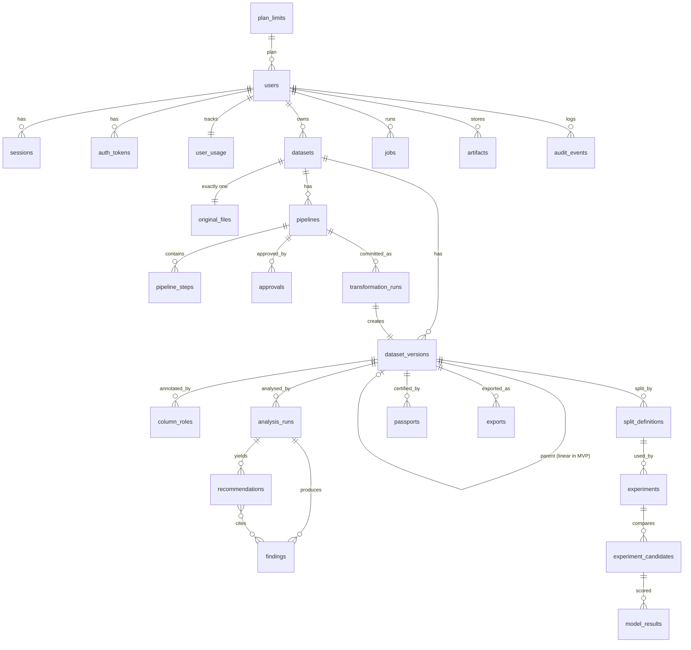

# DataMedic — Database Schema

| | |
|---|---|
| Status | Revision 2, MVP-scoped |
| Database | PostgreSQL (major pinned in Phase 1) |
| Migrations | Alembic, expand/contract |

## 1. Conventions

- Primary keys are `uuid` (`gen_random_uuid()`).
- **Tenancy**: every user-owned table has `owner_id uuid NOT NULL REFERENCES users(id)`, an index on it, and an RLS policy (§5). There is no workspace layer in the MVP; the Future migration path is in [ARCHITECTURE.md §17](ARCHITECTURE.md).
- Timestamps are `timestamptz` UTC. Enumerations are `text` + `CHECK`.
- **Job status lives only in `jobs` (D10).** Run tables (`analysis_runs`, `transformation_runs`, `experiments`, `passports`, `exports`) reference `job_id` and store inputs and results only. Result-quality fields such as `exports.validation_status` and `passports.readiness_status` are outcomes, not job states.
- No dataset cell values are stored in Postgres, with two exceptions, both owner-only under RLS and never logged:
  - capped example values in `findings.evidence` (≤ 5 values, ≤ 64 chars each, omitted for `sensitive` columns);
  - the preview, which is stored as an artifact in object storage rather than in Postgres.
- Soft-delete uses `deleted_at` on `users` and `datasets`. Children are hidden through the parent and hard-purged.
- Every child table carries its own `owner_id`, set by the service from the parent. A trigger verifies `child.owner_id = parent.owner_id` on insert. (This replaces revision 1's composite foreign keys.)

## 2. Entity-relationship overview



## 3. Tables

### 3.1 Identity, plans, usage

**users**
| Column | Type | Notes |
|---|---|---|
| id | uuid PK | |
| email | citext UNIQUE NOT NULL | |
| email_verified_at | timestamptz | Required before upload |
| password_hash | text NOT NULL | Argon2id |
| display_name | text | |
| plan | text NOT NULL default `'free'` FK→plan_limits(plan) | |
| status | text CHECK in (`active`,`deleting`) | |
| failed_login_count | int default 0 | Drives progressive delay |
| last_failed_login_at | timestamptz | |
| deleted_at, created_at, updated_at | timestamptz | |

(`mfa_totp_secret_enc` is added in V2.)

**sessions**: `id`, `user_id` FK ON DELETE CASCADE, `token_hash bytea UNIQUE` (SHA-256 of the 256-bit cookie token), `csrf_token text` (per-session synchroniser token), `created_at`, `last_seen_at`, `expires_at`, `revoked_at`, `user_agent`, `ip_prefix`.

**auth_tokens**: `id`, `user_id`, `purpose CHECK in ('verify_email','reset_password')`, `token_hash UNIQUE`, `expires_at`, `used_at`.

**plan_limits** (config, not tenant data)
| Column | Default (`free`) |
|---|---|
| plan text PK | `free` |
| max_upload_bytes bigint | 209715200 (200 MB) |
| max_storage_bytes bigint | 5368709120 (5 GB) |
| max_datasets int | 25 |
| max_versions_per_dataset int | 30 |
| max_cells bigint | 20000000 |
| max_columns int | 2000 |
| max_running_jobs int | 2 |
| max_queued_jobs int | 10 |
| max_experiment_candidates int | 3 |
| max_experiment_models int | 4 |
| export_retention_days int | 30 |

**user_usage** (1:1 user): `user_id PK`, `storage_bytes bigint`, `dataset_count int`, `updated_at`. Updated in the same transaction as each object registration or deletion. A nightly reconciliation job recomputes it from `original_files`, `dataset_versions`, `artifacts` and `exports`.

### 3.2 Datasets and storage

**datasets**
| Column | Type | Notes |
|---|---|---|
| id | uuid PK | |
| owner_id | uuid NOT NULL | |
| name | text NOT NULL | |
| domain | text NOT NULL default `'generic'` | Registered domain key |
| domain_changed_at | timestamptz | Set when the domain changes (D8). Displayed; staleness itself uses the semantics hash. |
| status | text CHECK in (`upload_pending`,`validating`,`validated`,`parsing`,`parse_failed`,`ready`,`rejected`,`deleting`) | Dataset lifecycle, not a job status. `validated` = upload passed integrity and content validation, awaiting parsing (Phase 1 stops here). |
| head_version_id | uuid FK→dataset_versions DEFERRABLE INITIALLY DEFERRED | MVP invariant: the highest `version_number` |
| declared_size_bytes | bigint | From `POST /datasets` |
| deleted_at, created_at, updated_at | | |

**original_files** (exactly one per dataset, insert-only)
| Column | Type | Notes |
|---|---|---|
| id | uuid PK | |
| owner_id, dataset_id | uuid; UNIQUE(dataset_id) | |
| object_key | text NOT NULL | `raw/{owner_id}/{dataset_id}/{uuid}` |
| sha256 | bytea NOT NULL | Computed by the API while streaming |
| size_bytes | bigint NOT NULL | |
| detected_format | text CHECK in (`csv`,`xlsx`,`xls`,`parquet`,`json`) | Set by ingest |
| original_filename | text | Display only, never used as a path |
| created_at | | |

A trigger rejects any `UPDATE` of `object_key`, `sha256` or `size_bytes`. `detected_format` may be set once, from NULL.

**dataset_versions** (insert-only except `deleted_at`)
| Column | Type | Notes |
|---|---|---|
| id | uuid PK | |
| owner_id, dataset_id | uuid | |
| version_number | int NOT NULL | UNIQUE(dataset_id, version_number); 0, 1, 2 … |
| kind | text CHECK in (`ingest`,`reparse`,`transform`,`revert`) | |
| parent_version_id | uuid FK NULL | NULL only for `ingest` |
| restored_from_version_id | uuid FK NULL | Required iff `kind='revert'` |
| transformation_run_id | uuid FK NULL | Required iff `kind='transform'` |
| parse_options | jsonb NULL | Required iff kind in (`ingest`,`reparse`) |
| object_key | text NOT NULL | `versions/{owner_id}/{dataset_id}/{version_id}.parquet` |
| file_sha256 | bytea NOT NULL | Integrity of the stored bytes |
| content_hash | bytea NOT NULL | Semantic hash ([ARCHITECTURE.md §9.3](ARCHITECTURE.md)) |
| n_rows, n_cols | bigint, int | `n_cols` excludes `_dm_row_id` |
| schema | jsonb NOT NULL | `[{name, original_name, dtype, inferred_type, n_missing, n_unique}]` |
| diff_summary | jsonb | vs parent |
| fitted_on_full_data | bool NOT NULL default false | |
| engine_version | text NOT NULL | |
| library_versions | jsonb NOT NULL | |
| created_by | uuid | |
| deleted_at, created_at | | |

Constraints:
- `CHECK ((kind='ingest') = (parent_version_id IS NULL))`
- `CHECK ((kind='revert') = (restored_from_version_id IS NOT NULL))`
- `CHECK ((kind='transform') = (transformation_run_id IS NOT NULL))`
- `CHECK ((kind IN ('ingest','reparse')) = (parse_options IS NOT NULL))`

The MVP linearity rule (parent = current head) is enforced in the service and the worker under the per-dataset advisory lock. **The schema itself allows a DAG**, so V2 forks need no migration.

**column_roles** (editable per version; copied to each new version with columns tracked through renames and drops)
| Column | Type | Notes |
|---|---|---|
| id | uuid PK | |
| owner_id, dataset_version_id | uuid | |
| column_name | text NOT NULL | |
| role | text NOT NULL | Universal or domain role key |
| task_type | text NULL CHECK in (`binary`,`multiclass`,`regression`) | **Required iff role = `target` (D7)** |
| source | text CHECK in (`user`,`suggested_accepted`) | |
| created_by, created_at | | |

UNIQUE(`dataset_version_id`, `column_name`, `role`), with a partial unique index allowing one `target` per version.

**reference_ranges** (biomedical module data, per dataset): `id`, `owner_id`, `dataset_id`, `column_name`, `unit NULL`, `low numeric`, `high numeric`, `source text NOT NULL`, `created_by`, `created_at`. CHECK (`low < high`).

**Semantics hash**: SHA-256 of (dataset domain, sorted roles, task type, reference-range set hash) for a version. It is computed by the service (not stored on the version) and stored on runs.

**artifacts**
| Column | Type | Notes |
|---|---|---|
| id | uuid PK | |
| owner_id | uuid | |
| owner_type, owner_ref_id | text, uuid | `dataset_version`, `analysis_run`, `transformation_run`, `experiment`, `passport`, `export`, `finding` |
| kind | text CHECK in (`preview`,`row_refs`,`impact_preview`,`fitted_state`,`fold_assignment`,`oof_predictions`,`version_comparison`,`passport_html`,`passport_json`,`export_bundle`) | |
| object_key | text NOT NULL | `artifacts/{owner_id}/…` |
| sha256 | bytea NOT NULL | |
| hmac | bytea | Required for `fitted_state` |
| size_bytes | bigint | Counted in usage |
| expires_at | timestamptz | |
| created_at | | |

### 3.3 Analysis

**analysis_runs**
| Column | Type | Notes |
|---|---|---|
| id | uuid PK | |
| owner_id, dataset_version_id | uuid | |
| job_id | uuid FK→jobs NOT NULL | Status comes from the job |
| kind | text CHECK in (`diagnostics`,`leakage_audit`,`privacy_scan`) | |
| suites | text[] NOT NULL | e.g. `{universal,biomedical}` |
| check_set_hash | bytea NOT NULL | |
| semantics_hash | bytea NOT NULL | For staleness (D8) |
| roles_snapshot | jsonb NOT NULL | |
| split_definition_id | uuid NULL | For leakage checks that inspect a split |
| config | jsonb | Budgets, seeds, thresholds |
| summary | jsonb | Counts by status × severity × domain, check error count |
| engine_version, library_versions | | |
| created_at, completed_at | | |

**findings** (immutable)
| Column | Type | Notes |
|---|---|---|
| id | uuid PK | |
| owner_id, analysis_run_id | uuid | |
| check_id, check_version | text NOT NULL | |
| domain | text NOT NULL | `universal` or a domain key |
| category | text NOT NULL | |
| status | text CHECK in (`passed`,`warning`,`failed`,`not_run`,`error`) | |
| severity | text CHECK in (`info`,`low`,`medium`,`high`,`critical`) | |
| title | text NOT NULL | |
| evidence | jsonb NOT NULL | |
| limitations | text[] NOT NULL | |
| not_run_reason | text | |
| error_code | text | |
| columns | text[] | |
| row_refs_artifact_id | uuid NULL | `_dm_row_id` list artifact |
| sampled | bool NOT NULL default false | |
| sample_info | jsonb | |
| created_at | | |

Constraints:
- `CHECK (status <> 'not_run' OR not_run_reason IS NOT NULL)`
- `CHECK (status <> 'error' OR error_code IS NOT NULL)`
- `CHECK (status IN ('not_run','error') OR evidence <> '{}'::jsonb)`

### 3.4 Recommendations

**recommendations**: `id`, `owner_id`, `analysis_run_id`, `dataset_version_id`, `rule_id`, `rule_version`, `domain`, `title`, `rationale`, `proposed_steps jsonb` (Step[]), `risk CHECK in ('low','medium','high')` (max of steps), `destructive bool` (any step destructive), `expected_effect jsonb`, `alternatives jsonb`, `status CHECK in ('open','used','dismissed')`, `created_at`, `updated_at`.

**recommendation_findings**: `owner_id`, `recommendation_id`, `finding_id`; PK(`recommendation_id`, `finding_id`).

### 3.5 Pipelines, approvals, commit

**pipelines**
| Column | Type | Notes |
|---|---|---|
| id | uuid PK | |
| owner_id, dataset_id | uuid | |
| source_version_id | uuid NOT NULL | Must equal the dataset head at commit time (MVP linearity) |
| name | text | |
| state | text CHECK in (`draft`,`validated`,`committed`,`archived`) | Edit state, not a job status |
| spec_hash | bytea NOT NULL | **Recomputed by the service on every step add, edit, delete or reorder (D9)**. Any change resets `state` to `draft`. |
| validation_report | jsonb | |
| impact_preview_artifact_id | uuid NULL | Computed for the current `spec_hash` only |
| impact_preview_spec_hash | bytea NULL | Preview is valid iff it equals `spec_hash` |
| created_by, created_at, updated_at | | |

**pipeline_steps**
| Column | Type | Notes |
|---|---|---|
| id | uuid PK | |
| owner_id, pipeline_id | uuid | |
| position | int NOT NULL | UNIQUE(pipeline_id, position) DEFERRABLE |
| op, op_version | text NOT NULL | |
| params | jsonb NOT NULL | |
| columns | text[] | |
| risk | text NOT NULL | Server-derived from the registry |
| destructive | bool NOT NULL | Server-derived |
| kind | text CHECK in (`stateless_row`,`stateless_column`,`fitted`,`row_filter_rule`,`row_filter_fitted`) | Server-derived |
| step_hash | bytea NOT NULL | SHA-256(canonical JSON of op, op_version, params, columns) |
| from_recommendation_id | uuid NULL | |
| created_at, updated_at | | |

**approvals** (insert-only)
| Column | Type | Notes |
|---|---|---|
| id | uuid PK | |
| owner_id, pipeline_id | uuid | |
| pipeline_step_id | uuid NULL | Set for `scope='step'` |
| scope | text CHECK in (`step`,`pipeline`) | `step` for each high-risk step; `pipeline` once if any medium-risk step exists |
| approved_hash | bytea NOT NULL | `step_hash` or `spec_hash` |
| impact_shown | jsonb NOT NULL | The exact impact numbers displayed |
| statement | text NOT NULL | Confirmation text displayed (includes the "Destructive" wording when applicable) |
| approved_by | uuid | |
| created_at | | |

Validity: a step approval is valid iff `approved_hash` equals the step's current `step_hash` **and** its `impact_shown` came from a preview whose `impact_preview_spec_hash` equalled the pipeline's `spec_hash` at approval time. A pipeline confirmation is valid iff `approved_hash` equals the current `spec_hash`.

**transformation_runs**
| Column | Type | Notes |
|---|---|---|
| id | uuid PK | |
| owner_id, pipeline_id | uuid | |
| job_id | uuid NOT NULL | |
| source_version_id | uuid NOT NULL | |
| result_version_id | uuid UNIQUE NULL | |
| spec_snapshot | jsonb NOT NULL | |
| spec_hash | bytea NOT NULL | |
| approval_ids | uuid[] NOT NULL | Verified in the worker |
| step_reports | jsonb | Per step: rows in/out, columns changed, values changed, warnings |
| fitted_state_artifact_id | uuid NULL | |
| seeds, engine_version, library_versions | | |
| executed_by, created_at, completed_at | | |

**version_events** (insert-only): `id`, `owner_id`, `dataset_id`, `event CHECK in ('created','reverted','reparsed')`, `version_id`, `related_version_id`, `actor_id`, `created_at`.

### 3.6 Experiments (evaluation; never writes versions)

**split_definitions**
| Column | Type | Notes |
|---|---|---|
| id | uuid PK | |
| owner_id, dataset_version_id | uuid | |
| strategy | text CHECK in (`kfold`,`stratified_kfold`,`group_kfold`,`stratified_group_kfold`,`time_series`) | |
| n_splits | int | |
| group_column, time_column, stratify_column | text | |
| seed | int NOT NULL | |
| fold_assignment_artifact_id | uuid NOT NULL | Map `_dm_row_id` → fold, frozen; whole split groups (group role ∪ duplicate clusters) share a fold (D2) |
| cohort | jsonb NOT NULL | `{rows, excluded_missing_target, duplicate_groups, rows_in_duplicate_groups}` |
| warnings | jsonb | |
| created_by, created_at | | |

(The V2 holdout adds `holdout jsonb` and `holdout_access_log`.)

**experiments**
| Column | Type | Notes |
|---|---|---|
| id | uuid PK | |
| owner_id, split_definition_id | uuid | |
| job_id | uuid NOT NULL | |
| target_column | text | |
| task_type | text | Copied from the target role |
| models | text[] | ⊆ {`dummy`,`linear`,`hgb`,`xgb`} |
| metrics | text[] | |
| summary | jsonb | Leaderboard, paired per-fold differences, warnings |
| seeds, engine_version, library_versions | | |
| created_by, created_at, completed_at | | |

**experiment_candidates**: `id`, `owner_id`, `experiment_id`, `label`, `steps jsonb` (Step[], may be empty), `spec_hash`, `source_pipeline_id NULL`, `max_risk`, `has_destructive bool`, `training_rows_removed jsonb` (per fold and per step, total, mean), `effects jsonb` (columns changed), `comparable bool`, `comparability_reason text NULL`. Test rows are never removed by candidates.

**model_results**: `id`, `owner_id`, `experiment_candidate_id`, `model`, `fold int NULL` (NULL = aggregate), `metrics jsonb`, `n_test_rows int`, `oof_artifact_id`, `warnings jsonb`.

### 3.7 Passports and exports

**passports** (immutable snapshots)
| Column | Type | Notes |
|---|---|---|
| id | uuid PK | |
| owner_id, dataset_version_id | uuid | |
| job_id | uuid NOT NULL | |
| semantics_hash | bytea NOT NULL | |
| source_analysis_run_ids | uuid[] NOT NULL | |
| source_experiment_ids | uuid[] NOT NULL | |
| export_id | uuid NULL | Set when generated as part of an export |
| readiness_status | text CHECK in (`ready`,`ready_with_warnings`,`not_ready`) | |
| readiness | jsonb NOT NULL | Checklist items with status and evidence |
| content | jsonb NOT NULL | The passport document (also stored as the `passport_json` artifact) |
| html_artifact_id, json_artifact_id | uuid | |
| created_by, created_at | | |

**exports**
| Column | Type | Notes |
|---|---|---|
| id | uuid PK | |
| owner_id, dataset_version_id | uuid | |
| job_id | uuid NOT NULL | |
| formats | text[] | `{parquet,csv}` |
| options | jsonb | e.g. `{csv_formula_escape:false, keep_row_id:false}` |
| bundle_artifact_id | uuid | |
| passport_id | uuid | |
| manifest | jsonb | |
| validation_status | text CHECK in (`validated`,`validated_within_tolerance`,`unvalidated`) | Outcome |
| validation_report | jsonb | |
| warnings | jsonb | e.g. `CSV_FORMULA_RISK` |
| expires_at | timestamptz | |
| created_by, created_at | | |

### 3.8 Jobs

**jobs**
| Column | Type | Notes |
|---|---|---|
| id | uuid PK | |
| owner_id | uuid | |
| type | text | `ingest`,`reparse`,`analysis`,`recommend`,`impact_preview`,`commit`,`revert`,`compare_versions`,`experiment`,`passport`,`export`,`purge` |
| queue | text | |
| dataset_id | uuid NULL | For per-dataset admission rules |
| subject_type, subject_id | text, uuid | |
| params | jsonb | Non-sensitive job parameters (IDs, options). **Never sent through the broker.** |
| status | text CHECK in (`queued`,`running`,`succeeded`,`failed`,`cancel_requested`,`cancelled`) | **Only status machine (D10)** |
| progress | jsonb | `{phase, pct}` |
| attempt | int default 0 | |
| idempotency_key | text | UNIQUE(owner_id, idempotency_key) |
| result | jsonb | Non-sensitive outcome summary (e.g. `{objects_deleted, verified_empty}`) |
| error | jsonb | `{code, message, retryable}`, no data values |
| worker_id | text | |
| heartbeat_at, queued_at, started_at, finished_at, last_published_at | timestamptz | |

Indexes: `(status, heartbeat_at)` for the reaper, `(status, last_published_at)` for requeue, `(owner_id, status)` for admission control. A partial unique index on `(dataset_id)` WHERE `type IN ('commit','revert','reparse')` AND status IN (`queued`,`running`) enforces one mutation job per dataset.

**claim_job(job_id uuid, worker_id text) RETURNS TABLE(owner_id uuid, type text)**: `SECURITY DEFINER`, owned by `dm_maintenance`. It atomically updates `queued → running` (incrementing `attempt`) and returns nothing if the job is not claimable.

### 3.9 Audit and deletion

**audit_events** (append-only; app role has INSERT only): `id`, `owner_id NULL`, `actor_user_id`, `action` (e.g. `login.succeeded`, `login.failed`, `dataset.deleted`, `approval.granted`, `pipeline.committed`, `version.reverted`, `export.downloaded`, `passport.downloaded`), `subject_type`, `subject_id`, `metadata jsonb` (no data values), `ip_prefix`, `created_at`.

**deletion_requests**: `id`, `owner_id`, `subject_type CHECK in ('dataset','export','user')`, `subject_id`, `requested_by`, `status CHECK in ('pending','purging','completed','failed')`, `receipt jsonb`, `requested_at`, `completed_at`.

**tombstones**: `id`, `subject_type`, `subject_id`, `deleted_at`, `deletion_request_id`. No names or content.

## 4. Integrity rules

1. `datasets.head_version_id` references a version of the same dataset (trigger). The MVP service guarantees it is the highest `version_number`.
2. `parent_version_id` and `restored_from_version_id` are in the same dataset (trigger). Insert-only, so the history is acyclic.
3. Child `owner_id` equals parent `owner_id` (trigger on every child table).
4. `pipeline_steps.risk`, `destructive` and `kind` are written only by the service from the registry.
5. `pipelines.spec_hash` is recomputed in the same transaction as any step mutation, and `state` is reset to `draft`.
6. `reparse` versions are allowed only while no `transform` or `revert` version exists for the dataset (service rule → `REPARSE_NOT_ALLOWED`).
7. `version_number` < `plan_limits.max_versions_per_dataset` (service rule → `QUOTA_EXCEEDED`).

## 5. Row-Level Security

```sql
ALTER TABLE datasets ENABLE ROW LEVEL SECURITY;
ALTER TABLE datasets FORCE ROW LEVEL SECURITY;
CREATE POLICY owner_isolation ON datasets
  USING (owner_id = current_setting('app.user_id', true)::uuid)
  WITH CHECK (owner_id = current_setting('app.user_id', true)::uuid);
```

- Applied to every user-owned table: datasets, original_files, dataset_versions, column_roles, reference_ranges, artifacts, analysis_runs, findings, recommendations, recommendation_findings, pipelines, pipeline_steps, approvals, transformation_runs, version_events, split_definitions, experiments, experiment_candidates, model_results, passports, exports, jobs, user_usage, deletion_requests and audit_events (read).
- `users`, `sessions` and `auth_tokens` are **not** RLS-protected (login and token lookups happen before a user is known). They are accessed only by the `auth` module through narrow queries by ID, email or token hash; no other module may query them. (Phase 1 decision; simpler than SECURITY DEFINER lookup functions.)
- The API runs `SET LOCAL app.user_id = :uid` at the start of every transaction, inside a SQLAlchemy session hook, so it cannot be forgotten. A missing setting returns zero rows (fail closed).
- Workers set the same value from `claim_job`'s returned `owner_id`.
- `dm_maintenance` (`BYPASSRLS`) is used only by `claim_job`, purge, reaper, requeue, expiry and usage reconciliation.

## 6. Retention and deletion

| Data | Retention | Mechanism |
|---|---|---|
| Original, versions, artifacts, passports | Until the user deletes the dataset or account | Purge job: delete objects by prefix → delete rows in FK order → tombstone + receipt → verify the prefix is empty |
| Exports | 30 days (`plan_limits.export_retention_days`) | Expiry job |
| `upload_pending` datasets without content | 24 h | Expiry job (rows only; nothing stored) |
| Sessions | Idle 7 d, absolute 30 d | Expiry job |
| audit_events | 1 year | Monthly partitions |
| Backups | 30 days | Disclosed to users |

## 7. Changes from revision 1 (summary)

| Change | Reason |
|---|---|
| `workspaces`, `workspace_members`, `privacy_settings` removed; `owner_id` everywhere; RLS on `app.user_id` | Approved MVP simplification |
| `plan_limits`, `user_usage` added | Quotas and job limits |
| `dataset_versions.kind` now includes `reparse` and `revert`; added `restored_from_version_id`, `file_sha256` and `content_hash` (replacing `content_sha256`) | D3, D4, D5, linear revert |
| `task_type` moved from `datasets` to the target `column_roles` row | D7 |
| `domain_changed_at` + `semantics_hash` on runs | D8 |
| `spec_hash` maintained on every step mutation; impact preview bound to `spec_hash` | D9 |
| Status columns removed from run tables; `job_id` required | D10 |
| `split_definitions.fold_assignment_artifact_id` keyed by `_dm_row_id` | D1, D2 |
| `evaluation_*` renamed `experiment_*`; candidates carry `max_risk`, `has_destructive` and `effects` | Experiment labelling |
| `passports` added | Data Health Passport |
| `pipeline_steps.destructive`, `approvals.impact_shown` | Destructive labelling and impact before approval |
| `uploads` table and presigned fields removed | Streaming upload |
| `outbox` removed; `jobs.last_published_at` + `claim_job` | Simplified orchestration |
| `llm_egress_log`, holdout log, MFA fields deferred | V2 |
| Composite FKs replaced by owner-consistency triggers | Simplification |
